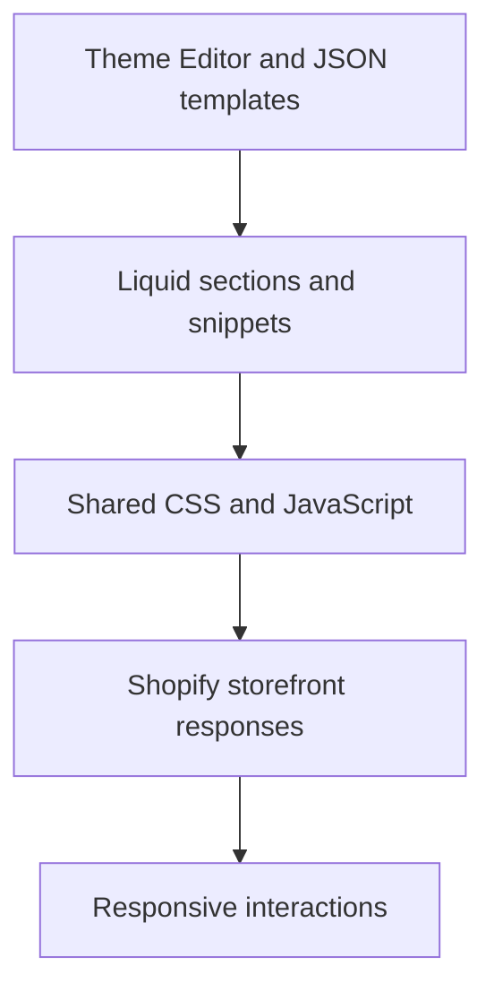

# Shopify Storefront Systems

Storefront implementation and refinement across native Shopify page templates, merchant-editable sections, predictive search and collection filtering.

**Technical showcase · Documentation only · Anonymized**

Shopify Online Store 2.0 | Liquid | JavaScript | CSS | Shopify CLI | Playwright

## Engineering problem

Storefront changes must work together across the header, product pages, collection controls and cart while remaining editable through the Theme Editor. A fix at one viewport must not disturb the shared layout at another.

## Implementation scope

- Worked across homepage, product, collection and cart template composition using native theme surfaces.
- Implemented and refined predictive search with combobox/listbox behavior, keyboard navigation and Escape handling.
- Integrated Shopify suggestion responses into distinct suggestion and product groups.
- Refined collection filtering, popup state, active-filter controls and loading feedback.
- Used focused browser geometry checks and remote theme readbacks to separate source changes from rendered behavior.

## Architecture at a glance

The following is an illustrative technical flow, not a client screenshot or a deployment topology.

## Evidence and delivery boundary

Implemented storefront contributions with feature-level runtime and theme-readback evidence.

Retained runtime evidence records successful predictive-search responses and rendered groups. Additional browser checks target filter geometry and state. These are focused observations, not an exhaustive storefront audit.

## Read more

- [Engineering decisions](docs/engineering.md)
- [Scope and evidence boundaries](docs/scope.md)

> This repository describes verified implementation work at a technical level. Original source, identities, business data and visual assets are intentionally omitted. It is not an installable application or a claim that the original private implementation is open source.
